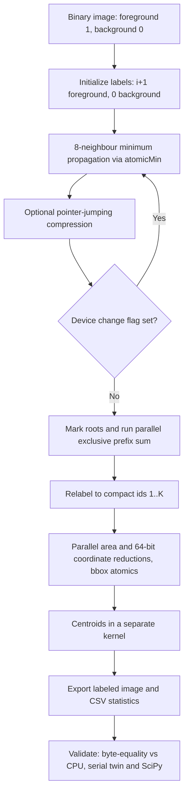

# GPU-Based Connected-Component Labeling with CUDA

**8-connected image labeling with GPU-side convergence detection, deterministic compaction, parallel component statistics, and byte-exact cross-validation against independent references.**

[](https://developer.nvidia.com/cuda-toolkit)


**IIT Jodhpur · PG Diploma in AI · GPU Programming · Problem 3**
**Team:** Ritesh Maury (G25AIT2087) · Shrikrishna Tripathi (G25AIT2103) · Alok Sahni (G25AIT2138)

---

## Submission links

| Item | Link | Status |
|---|---|---|
| GitHub Repository | https://github.com/riteshmaury-iitj/gpu-assignment | Live — public |
| Kaggle Notebook v1 | `https://www.kaggle.com/` | URL to be filled |
| Kaggle Notebook v2 | `https://www.kaggle.com/` | URL to be filled |
| Hugging Face Model | `https://huggingface.co/` | Artefact not yet created |
| Docker Image | `https://hub.docker.com/` | Artefact not yet created |
| W&B Dashboard | `https://wandb.ai/` | Artefact not yet created |
| W&B Report | `https://wandb.ai/` | Artefact not yet created |

> **Before submission.** Only the repository row is live; the rest carry the host domain alone. The four rows marked *Artefact not yet created* have no counterpart in this source tree — the project trains no model, ships no container and records no Weights & Biases runs. If the submission template requires them, the artefacts have to be produced first (a Kaggle notebook that compiles and runs the CUDA lab on a T4, a Docker image wrapping the `nvcc` build and the verification matrix, W&B logging of the benchmark sweep in `python/benchmark.py`). If it does not, mark them *Not applicable* rather than linking a bare domain.

The report, handbook, 18-slide presentation, narrated video, Colab notebook, browser demo, results CSVs and guides travel inside the submission archive (`01_Report` … `09_Guides`) and need no external link.

## Overview

Connected-Component Labeling (CCL) groups adjacent foreground pixels in a binary image into distinct objects. This project implements an **8-connected CCL pipeline in CUDA C/C++**, with an independent **single-threaded CPU baseline**, a **serial twin** that compiles the same per-pixel source as the kernels, and Python tools for image generation, verification, visualization and benchmarking.

For each foreground component the output is a compact integer label, **area**, **centroid** and **axis-aligned bounding box**. This is an **educational implementation, not a production medical-imaging or vision system**.

> **Status.** 480/480 checks pass across the CPU and serial-twin matrix on any machine, and the previous revision passed 636/636 device-inclusive checks plus 20/20 bit-identical labellings of a 4096×4096 image on a Tesla T4. **The current revision has not yet been re-run on a GPU**, and two `initcheck` findings from the earlier T4 run are unresolved. No native-device speed-up is claimed anywhere in this repository.

## Key features

- **8-connectivity** — horizontal, vertical and diagonal foreground neighbours are connected.
- **Three independent strategies** — `--algo prop` (in-place iterative propagation, the default), `--algo dbuf` (double-buffered, race-free by construction), `--algo uf` (non-iterative union-find). All three must produce byte-identical output.
- **GPU-resident convergence flag** — a device atomic flag raised with `atomicMax`; **4 bytes** per iteration cross the bus instead of the full label image (64 MB at 4096², a factor of ~16 million).
- **Atomic-only label updates** — every write is an `atomicMin`, every concurrent read goes through `ccl_load_relaxed()`; `make cuda-strict` substitutes libcu++ `cuda::atomic_ref` for exactness against the CUDA memory model.
- **Deterministic compaction** — labels are compacted to `1..K` by a hand-written recursive parallel exclusive prefix sum, not an atomic counter, so component ids are a pure function of the input.
- **Parallel component statistics** — `atomicAdd` (64-bit coordinate sums), `atomicMin` and `atomicMax` for area, centroids and inclusive bounding boxes; results are bit-reproducible.
- **Byte-exact validation** — because the fixed point is unique, CPU BFS, the serial twin and all three GPU algorithms are compared with `memcmp`, not partition equivalence.
- **GPU-free verification** — NVRTC device compilation, clang host-only type-checking against a declarations-only CUDA shim, and a PTX audit confirming the intended atomics were emitted.

## Technology stack

| Layer | Tools / techniques |
|---|---|
| GPU implementation | CUDA C/C++, CUDA Runtime API, kernel launches, device atomics, pinned host memory, streams and events |
| CPU reference | C99, BFS flood fill, serial label propagation |
| Serial twin | C++11, compiles the same per-pixel bodies as the kernels, permutable visit order |
| Test and analysis | Python 3, NumPy, SciPy (`ndimage`), Matplotlib, pandas |
| Static verification | NVRTC, clang (CUDA host-only mode), PTX audit, compute-sanitizer |
| Development | Git/GitHub, GNU Make, GCC, NVIDIA `nvcc`; Windows build script |
| Target GPU | NVIDIA Tesla T4 (`sm_75`); other CUDA devices with a compatible `-arch` |

## Architecture and processing workflow



**Connectivity rule:** for pixel `(x, y)`, consider offsets `dx, dy ∈ {-1, 0, 1}` excluding `(0, 0)`, keeping only in-bounds foreground neighbours.

**Statistics for component `k`:** area is its pixel count; `cx = sum(x) / area`, `cy = sum(y) / area`; the bounding box is `(xmin, ymin, xmax, ymax)` in inclusive pixel coordinates.

### Why the in-place version is race-safe

Two invariants carry the argument. **(I1)** `labels[L-1] ≤ L` for every foreground label — updates go only through `atomicMin`, so a label can only decrease, and only to a value already held by a pixel in the same component. **(I2)** following `parent(L) = labels[L-1]` strictly decreases until a root is reached, so the chain is acyclic and `find_root` always terminates even while other threads mutate the array.

A stale read is therefore harmless: a reader can observe only a value ≥ the current one, and any value it observes was at some point a legitimate label of a pixel in that same component — so a stale read can delay convergence but cannot merge two components or split one.

**This is an argument, not a proof that the code implements it.** `--cross-check`, the 20× repeat-determinism test and `make sanitize` are the hardware checks that test it, and the two unresolved `initcheck` findings are listed under [Known issues](#known-issues).

## Quick start

### Prerequisites

- Python 3 with `numpy`; `scipy` for the reference, `matplotlib` for plots, `pandas` for benchmarks.
- GCC or another supported C compiler for the CPU executable and the serial twin.
- To run the CUDA executable: an NVIDIA CUDA-capable GPU, a supported driver, and CUDA Toolkit with `nvcc` on `PATH`.

```bash
# Clone
git clone https://github.com/riteshmaury-iitj/gpu-assignment.git
cd gpu-assignment

# Python analysis dependencies
python3 -m pip install numpy scipy matplotlib pandas

# CPU reference + serial twin (no CUDA needed)
make

# CUDA target, on a machine with the toolkit
make cuda ARCH=sm_75
```

On Windows, open an **x64 Native Tools Command Prompt for Visual Studio** with `nvcc` available and run `build_windows.bat sm_75`. This path has not been independently re-tested for the current revision.

### Example: generate, label, verify, visualize

```bash
# 1. Deterministic 512x512 binary image
python3 python/gen_image.py blobs.bin 512 512 --kind blobs --density 0.3 --seed 42 --png blobs.png

# 2. CPU reference
./ccl_cpu --image blobs.bin --algo bfs --out-labels labels_cpu.bin --out-stats stats_cpu.csv

# 3. CUDA implementation (NVIDIA GPU required)
./ccl_cuda --image blobs.bin --out-labels labels_gpu.bin --out-stats stats_gpu.csv --verbose

# 4. Compare against the CPU reference — byte-exact, not just partition-equivalent
python3 python/verify.py blobs.bin labels_gpu.bin stats_gpu.csv --ref-labels labels_cpu.bin

# 5. Visualization
python3 python/visualize.py blobs.bin labels_gpu.bin stats_gpu.csv components.png
```

**CPU-only verification:** run step 2, then `python3 python/verify.py blobs.bin labels_cpu.bin stats_cpu.csv`.

### Verification targets

```bash
make test        # verification matrix, CPU + serial twin        → 480 / 480
make test-cuda   # the same matrix including the GPU             → needs a device
make check       # NVRTC device compile + clang host type-check  → no GPU required
make sanitize    # compute-sanitizer racecheck/memcheck/synccheck/initcheck
```

**Output formats:** images and labels use an 8-byte header (`int32 width`, `int32 height`) followed by row-major pixels (`uint8`) or labels (`int32`). CSV columns are `id,area,cx,cy,xmin,ymin,xmax,ymax`. Centroids are written with `%.12g` — at `%.6f` a value such as `198.118055555…` loses enough precision to fail an exactness check as a pure artefact of the text format.

### Benchmark (after hardware correctness is re-established)

```bash
mkdir -p results figures
python3 python/benchmark.py --exe ./ccl_cuda --cpu ./ccl_cpu \
  --sizes 256,512,1024,2048,4096 --kinds blobs,noise,shapes --reps 5 \
  --out results/benchmark.csv
python3 python/plot_results.py results/benchmark.csv figures/fig5_gpu_benchmark.png
```

**Timing scopes are not interchangeable.** The programs report `label_ms` (CUDA events around the propagation loop), `label_plus_compact_ms`, `stats_ms` and `end_to_end_ms` (host wall clock including allocation, H2D, all kernels, D2H and file writes). Only `end_to_end_ms` is comparable with the CPU program's `end_to_end_ms`. `benchmark.py` emits `speedup_label` and `speedup_end_to_end` separately and never mixes scopes — **any speed-up quoted must name its scope.**

## Repository structure

```text
gpu-assignment/
├── src/
│   ├── ccl_core.h             # Per-pixel bodies as __host__ __device__, atomics, union-find
│   ├── ccl_kernels.cuh        # All 14 kernels, thin wrappers over ccl_core.h
│   ├── ccl_cuda.cu            # Host driver: streams, convergence loop, prefix sum, CLI
│   ├── ccl_sim.cpp            # Serial twin — same bodies, permutable visit order
│   ├── ccl_cpu.c              # Independent C99 reference: BFS + serial propagation
│   └── ccl_io.h               # Binary image / label I/O and the statistics CSV writer
├── python/
│   ├── gen_image.py           # 13 deterministic image kinds
│   ├── ccl_io.py              # I/O, canonical relabelling, statistics
│   ├── ccl_numpy.py           # NumPy/SciPy reference
│   ├── verify.py              # Partition, byte-equality and statistics checking
│   ├── benchmark.py           # Scope-aware CPU/GPU timing sweep
│   ├── plot_results.py        # Time / speed-up plots
│   ├── visualize.py           # Component visualization
│   └── parse_colab_output.py  # Benchmark summarization
├── tests/
│   ├── run_tests.py           # The verification matrix
│   ├── nvrtc_check.py         # Device compile with no nvcc
│   └── host_check.sh          # Host type-check with no CUDA toolkit (+ cudashim/)
├── Makefile
├── build_windows.bat
└── README.md
```

The separate coursework archive additionally holds the report, handbook, presentation, narrated video, Colab notebook, browser demo and results. Those assets are **not all present in this repository**, so this README does not link to repository paths that do not exist.

## Kernels

| Kernel | Launch | Role |
|---|---|---|
| `k_init` | 1-D, 256 | `labels[i] = img[i] ? i+1 : 0` |
| `k_prop_inplace` | 2-D, 32×8 | In-place 8-neighbour minimum propagation (`--algo prop`) |
| `k_prop_dbuf` | 2-D, 32×8 | Double-buffered propagation, read-one/write-other (`--algo dbuf`) |
| `k_compress` | 1-D, 256 | Pointer-jumping: replace a label by its current root |
| `k_uf_reduce` | 2-D, 32×8 | Union-find over the W/NW/N/NE edges (`--algo uf`) |
| `k_mark_roots` | 1-D, 256 | `flags[i] = 1` where `labels[i] == i+1` |
| `k_scan_block`, `k_add_offsets` | 1-D, 1024 + shared | Per-block Hillis-Steele exclusive scan, then block offsets added back |
| `k_assign_ids`, `k_relabel` | 1-D, 256 | Compact ids `1..K` via each root's scan slot |
| `k_stats_init` | 1-D, 256 over K+1 | Resets area, coordinate sums, bounding box |
| `k_stats_accum` | 2-D, 32×8 | `atomicAdd` area and 64-bit sums; `atomicMin`/`atomicMax` bbox |
| `k_centroid` | 1-D, 256 over K+1 | `cx = sum_x/area`, `cy = sum_y/area` |
| `k_count_diff` | 1-D, 256 | On-device label-image comparison used by `--cross-check` |

Blocks are 256 threads throughout; 2-D kernels use a 32×8 tile so a warp covers 32 contiguous pixels of one row and global loads coalesce. Thrust and CUB are deliberately not used, so the prefix sum is our own GPU work.

## Testing, results and evidence

| Evidence | Recorded finding | Interpretation |
|---|---|---|
| CPU and serial-twin matrix, 41 images × 12 configurations | **480 / 480 pass** | Reproducible on any machine, no GPU required |
| GPU-inclusive matrix, 41 images × 16 configurations (**previous** revision, Tesla T4) | **636 / 636 pass** | Device-inclusive; the current revision has not been re-run |
| Repeat determinism, 4096×4096 (**previous** revision, T4) | **20 / 20 bit-identical** | Races often appear only at scale |
| Order invariance, 4 image kinds × 2 algorithms × 12 visit orders | **96 runs → 1 distinct label image** | Iteration count varied, the result did not |
| 1100×1000 image (three levels of scan recursion) | **355 components, 0 differing pixels, statistics exact** | Crosses the 1024-element scan block size |
| Known-geometry canvas, 4 rectangles + 5 discs | **9 / 9 areas, centroids and boxes exact** | Predicted in closed form before measurement, SciPy-independent |
| CPU BFS baseline, 512×512 blobs | **≈2.0 ms label / ≈2.6 ms end-to-end** | 2-core Xeon @2.10 GHz, cloud container — not a reference platform |
| CPU BFS baseline, 2048×2048 noise | **≈64 ms / ≈91 ms** | Same environment |
| Tesla T4 timing and speed-up, current revision | **Pending** | No validated device benchmark is claimed |

Two recorded CPU baselines from different containers disagree by ~40% on the same workload (2.831 ms vs ≈2.0 ms for 512² blobs) — itself the argument for re-measuring on the submission machine rather than quoting either.

### Convergence behaviour — the dominant performance factor

Double-buffered propagation *is* the synchronous parallel model, so these sweep counts are hardware-independent, not an approximation:

| Image kind (n × n) | n = 64 | n = 128 | n = 256 | Behaviour |
|---|---|---|---|---|
| blobs (compact regions) | 47 | 76 | 169 | grows roughly with component diameter |
| noise (scattered) | 47 | 92 | 107 | nearly flat — best case for the GPU |
| spiral (one long path) | 125 | 253 | 509 | about `2n`: long but shallow |
| snake (one serpentine path) | 2 016 | 8 128 | 32 640 | exactly `n²/2 − n/2` — use `--algo uf` |

**The cost of GPU CCL is set by component geometry, not by pixel count.** This is why `uf` is the fast path and `dbuf` is a cross-check rather than the production algorithm.

### Edge cases with analytically derived answers

`K` is known by hand for these, so the test does not depend on SciPy. All matched across `cpu/bfs`, `prop`, `dbuf` and `uf`.

| Image | K | Reasoning |
|---|---|---|
| empty 64×64, empty 1×1 | 0 | no foreground; also the degenerate single-pixel image |
| full 64×64 | 1 | every pixel foreground |
| single 64×64 | 1 | one pixel at linear index 0 — checks that label 0 stays reserved |
| corners 64×64 | 4 | four isolated corner pixels |
| border 64×64 | 1 | the frame is one closed loop |
| checker 64×64 | 1 | diagonal-only adjacency; 8-connectivity joins all of it |
| snake 64×64 | 1 | a single serpentine path threading the image |
| diag 64×64 / 48×48 | 22 / 16 | chains every 3 columns → `⌈64/3⌉`, `⌈48/3⌉` |

The 41 test images also cover one-row and one-column images, very sparse and very dense noise, odd and non-square dimensions, and a 1025×3 image that crosses the prefix sum's 1024-element block size.

## Screenshots and demo

Placeholders for assets to add once the corresponding evidence is published:

| Suggested asset | What to demonstrate |
|---|---|
| **Binary input → labeled components** | Original image and colour-coded connected regions |
| **Area/centroid/bounding-box overlay** | Geometric properties of representative components |
| **CPU vs GPU performance plot** | Validated device timing and speed-up — only after the T4 re-run |
| **Short CUDA/Colab demo** | Compilation, correctness check, verbose convergence log, sample results |

<!-- After uploading verified images under docs/images/, enable these:


-->

## What is novel here

- **Byte-equality cross-validation instead of partition equivalence.** Because the fixed point is unique, three independent algorithms plus a raster-order CPU BFS must agree to the byte — `memcmp`, not a relabelling-tolerant comparison.
- **A serial twin that compiles the same source lines as the kernels.** `ccl_sim` includes `ccl_core.h` and calls the identical bodies, so an algorithmic bug is reproducible with no GPU, and `--order shuffle` turns order-independence into an empirical test.
- **Deterministic prefix-sum compaction rather than an atomic counter** — which is what makes the two points above possible at all.
- **A GPU-free static verification pipeline** — NVRTC device compilation, clang host-only type-checking, and a PTX audit confirming `atom.global.min.s32` and `atom.global.add.u64` were actually emitted.
- **Scope-separated timing with no mixed-scope speed-ups.**

## Known issues

1. **Two `initcheck` errors** from the previous revision's T4 run are unresolved — most likely in the device/host copy buffers around the cross-check path. Passing `racecheck` alone does not rule out all global-memory concurrency problems.
2. The optional `CCL_STRICT_ATOMICS` (libcu++) build is not proven to compile; it needs the toolkit's CCCL headers. Run `make cuda-strict` where they exist and record the result separately.
3. Maximum image size is `2³¹−2` pixels because labels are 1-based `int32` indices; 64-bit `atomicAdd` for statistics requires `sm_60` or newer (the program warns at startup on older devices).
4. Statistics use global atomics with no shared-memory privatisation, so an image with few very large components serialises on a handful of addresses.
5. No block-based (2×2) 8-connectivity optimisation is implemented; the literature shows this is what separates competitive 8-way GPU CCL from the plain pixel-based form.
6. `--cross-check` triples the work and must be off when benchmarking.

## Next steps

1. Re-run the current revision on a **Tesla T4**: `make test-cuda`, `--cross-check`, the 20× determinism test, and `make sanitize` with a clean exit status.
2. Resolve or document the two `initcheck` findings.
3. Regenerate benchmark CSVs and plots with warm-up discarded and five repetitions, and fill in the report's T4 table.
4. Run the block-size sweep (tile height and 1-D block size), reading occupancy from Nsight Compute rather than inferring it from timings.
5. Publish verification logs, labelled-image screenshots and benchmark CSV/plots under `docs/` or `results/`.
6. Implement Playne-Equivalence or block-based union-find and report the accuracy/performance trade-off.

## Team contributions

| Contributor | Area | Specific artefacts |
|---|---|---|
| **Ritesh Maury** (G25AIT2087) | CUDA label propagation, device-side convergence, path compression, repository ownership | `src/ccl_kernels.cuh`; convergence loop in `src/ccl_cuda.cu`; Makefile CUDA targets; repository and README |
| **Shrikrishna Tripathi** (G25AIT2103) | Component statistics, benchmarking methodology, visualisation | statistics stage in `src/ccl_cuda.cu` and the bodies in `src/ccl_core.h`; `python/benchmark.py`, `plot_results.py`, `visualize.py`; figures |
| **Alok Sahni** (G25AIT2138) | Algorithm study and literature survey, CPU reference, verification harness, documentation | `src/ccl_cpu.c`; `src/ccl_sim.cpp`; `tests/run_tests.py`, `nvrtc_check.py`, `host_check.sh`; `python/verify.py`; project report |

Integration, the build system, testing, the presentation and viva preparation were shared. The table indicates primary ownership only.

**AI-assisted work:** generative AI tools were used for conceptual clarification, debugging suggestions, code review and documentation assistance. All design decisions, integration, compilation, execution, testing, validation and interpretation of results were carried out by the team. Each contributor should confirm this statement against their own artefacts before final attribution.

## Contributing

Open an issue explaining the problem, environment, reproduction steps and expected behaviour. Changes go on a separate branch with a concise pull request, test cases, and evidence of any measured speed-up — naming the timing scope. Maintainers must respect course and institutional sharing rules.

## License and usage

**No open-source license is confirmed for this repository.** Public visibility alone does not grant reuse rights. Before adding a `LICENSE` file, the contributors should agree on authorship and verify that the coursework materials and third-party assets can legally be redistributed. Until then, request permission before copying or redistributing the code.

## References

1. Rosenfeld & Pfaltz, "Sequential operations in digital picture processing," *JACM* 13(4), 1966.
2. Hawick, Leist & Playne, "Parallel graph component labelling with GPUs and CUDA," *Parallel Computing* 36(12), 2010.
3. Kalentev, Rai, Kemnitz & Schneider, "Connected component labeling on a 2D grid using CUDA," *JPDC* 71(4), 2011.
4. Štava & Beneš, "Connected component labeling in CUDA," in *GPU Computing Gems*, ch. 35, 2011.
5. Playne & Hawick, "A new algorithm for parallel connected-component labelling on GPUs," *IEEE TPDS* 29(6), 2018.
6. Allegretti, Bolelli, Cancilla & Grana, "Optimizing GPU-based connected components labeling algorithms," *IPAS*, 2018.
7. Harris, Sengupta & Owens, "Parallel prefix sum (scan) with CUDA," in *GPU Gems 3*, ch. 39, 2007.
8. [NVIDIA CUDA C++ Programming Guide](https://docs.nvidia.com/cuda/cuda-c-programming-guide/)
9. [SciPy `ndimage.label` documentation](https://docs.scipy.org/doc/scipy/reference/generated/scipy.ndimage.label.html)

---

*Academic project: GPU Programming, Problem 3, IIT Jodhpur. CUDA execution and hardware-performance claims remain subject to native-device validation.*
