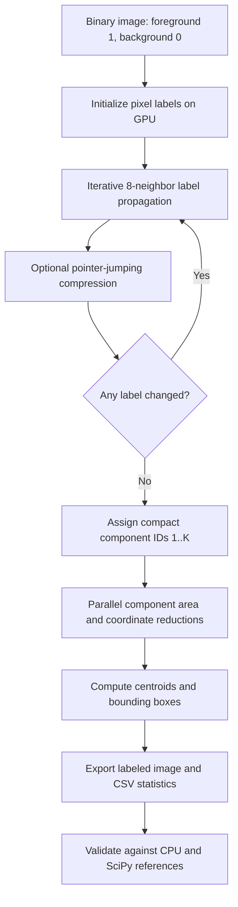

# GPU-Based Connected-Component Labeling with CUDA

**Parallel 8-connected image labeling with GPU-side convergence detection, component statistics, and a verifiable CPU reference.**

[](https://developer.nvidia.com/cuda-toolkit)


**IIT Jodhpur · PG Diploma in AI · GPU Programming · Problem 3**  
**Team:** Ritesh Maury · Shrikrishna Tripathi · Alok Sahni

## Overview

Connected-Component Labeling (CCL) groups adjacent foreground pixels in a binary image into distinct objects. This project implements an **8-connected CCL pipeline in CUDA C/C++**, with an independent **single-threaded CPU baseline** and Python tools for generating images, checking outputs, visualization, and benchmarking.

For each foreground component, the intended output includes a compact integer label, **area**, **centroid**, and **axis-aligned bounding box**. This pattern is useful in image segmentation and object-region analysis; the project is an **educational implementation, not a production medical-imaging or vision system**.

> **Validation status:** The supplied coursework package records 156/156 checks passing under CPU and *host-side CUDA emulation*. A separate fresh CPU-only check also passed. **Native NVIDIA GPU correctness, concurrency safety, and Tesla T4 performance are still to be established.** Do not interpret emulation results as hardware GPU benchmarks.

## Key features

- **8-connectivity:** treats horizontal, vertical, and diagonal foreground neighbors as connected.
- **CUDA parallel labeling:** initializes pixel labels and iteratively propagates minimum neighboring labels.
- **GPU-resident convergence flag:** checks changes using a device atomic flag; a **4-byte flag** is copied to the host per iteration instead of the full label image. Other input/output transfers still occur.
- **Optional path compression:** periodic label pointer-jumping to reduce propagation chains.
- **Compact component IDs:** assigns foreground components labels from `1` to `K`, reserving `0` for background.
- **Parallel component statistics:** uses device-side `atomicAdd`, `atomicMin`, and `atomicMax` for area, coordinate sums, and bounding boxes.
- **Independent validation:** CPU BFS, serial propagation, NumPy/SciPy 8-connectivity reference, and a partition-equivalence check that tolerates different component ID orders.
- **Reproducible experiments:** seeded synthetic image generation, CLI tools, CSV outputs, and benchmark plotting scripts.

## Technology stack

| Layer | Tools / techniques |
|---|---|
| GPU implementation | CUDA C/C++, NVIDIA CUDA Runtime, kernel launches, atomics |
| CPU reference | C, BFS flood fill, serial label propagation |
| Test and analysis | Python 3, NumPy, optional SciPy, Matplotlib, pandas |
| Development | Git/GitHub, GNU Make, GCC, NVIDIA `nvcc`; Windows build script |
| Target GPU | NVIDIA Tesla T4 (`sm_75`) for planned benchmarking; CUDA-capable devices may be used with a compatible `-arch` |

## Architecture and processing workflow



**Connectivity rule:** for pixel `(x, y)`, consider offsets `dx, dy ∈ {-1, 0, 1}`, excluding `(0, 0)`, and only those neighbors that lie inside image bounds and are foreground.

**Statistics for component** `k`: area is its pixel count; `cx = sum(x) / area`, `cy = sum(y) / area`; its bounding box is `(xmin, ymin, xmax, ymax)` (inclusive pixel coordinates).

### Engineering caveat: concurrent label updates

The current `src/ccl_cuda.cu` performs **in-place, non-atomic label reads/writes** in the propagation and compression kernels. Neighboring CUDA threads may access the same labels concurrently, which creates a potential data-race and memory-ordering correctness risk. CPU-side schedules and CUDA emulation tests **do not prove the absence of device-level races**. Before claiming a robust native-GPU implementation, run the actual CUDA tests and address/validate this behavior—for example, by investigating atomic minimum updates, a double-buffered propagation design, or another race-safe algorithm.

## Quick start

### Prerequisites

- Python 3 with `numpy`; install `scipy` for the SciPy reference, `matplotlib` for plots, and `pandas` for benchmarks.
- GCC or another supported C compiler for the CPU executable.
- To run the CUDA executable: an NVIDIA CUDA-capable GPU, a supported NVIDIA driver, and CUDA Toolkit with `nvcc` available on `PATH`.

```bash
# Clone this repository
git clone https://github.com/riteshmaury-iitj/gpu-assignment.git
cd gpu-assignment

# Install Python analysis dependencies
python3 -m pip install numpy scipy matplotlib pandas

# Build the CPU baseline only (works without CUDA)
gcc -O3 -o ccl_cpu src/ccl_cpu.c

# Build both targets on a suitable CUDA development machine
make ARCH=sm_75
```

On Windows, open an appropriately configured **x64 Native Tools Command Prompt for Visual Studio** with `nvcc` available and run `build_windows.bat sm_75` (adjust architecture to match your GPU). This Windows path has not been independently tested here.

### Example: generate, label, verify, visualize

```bash
# 1. Generate a deterministic 512x512 binary image
python3 python/gen_image.py blobs.bin 512 512 --kind blobs --density 0.3 --seed 42 --png blobs.png

# 2. Run CPU reference
./ccl_cpu --image blobs.bin --algo bfs --out-labels labels_cpu.bin --out-stats stats_cpu.csv

# 3. Run CUDA implementation (NVIDIA GPU required)
./ccl_cuda --image blobs.bin --out-labels labels_gpu.bin --out-stats stats_gpu.csv --verbose

# 4. Compare GPU component partitions and component statistics with CPU reference
python3 python/verify.py blobs.bin labels_gpu.bin stats_gpu.csv --ref-labels labels_cpu.bin

# 5. Create a visualization
python3 python/visualize.py blobs.bin labels_gpu.bin stats_gpu.csv components.png
```

**CPU-only verification:** run `python3 python/verify.py blobs.bin labels_cpu.bin stats_cpu.csv` after step 2, without a GPU.

**Output formats:** images and labels use an 8-byte header (`int32 width`, `int32 height`) followed by row-major pixels (`uint8`) or labels (`int32`). The CSV columns are `id,area,cx,cy,xmin,ymin,xmax,ymax`.

### Benchmark (only after hardware correctness is established)

```bash
mkdir -p results figures
python3 python/benchmark.py --exe ./ccl_cuda --cpu ./ccl_cpu \
  --sizes 256,512,1024 --kinds blobs,noise,shapes --reps 3 \
  --out results/benchmark.csv
python3 python/plot_results.py results/benchmark.csv figures/fig5_gpu_benchmark.png
```

**Timing note:** The CUDA program's reported `time_ms` is based on GPU events around on-device work; it does not include every host-to-device/device-to-host transfer. CPU timings use a different measurement boundary. Clearly document timing scopes and use like-for-like measurements before publishing end-to-end speed-up claims.

## Repository structure

The following structure reflects the **currently published GitHub repository**:

```text
gpu-assignment/
├── src/
│   ├── ccl_cuda.cu             # GPU kernels and CLI
│   └── ccl_cpu.c              # CPU BFS/propagation reference
├── python/
│   ├── benchmark.py           # CPU/GPU benchmark sweep
│   ├── ccl_io.py              # Binary image / label I/O
│   ├── ccl_numpy.py           # NumPy/SciPy reference
│   ├── gen_image.py           # Deterministic synthetic data
│   ├── parse_colab_output.py  # Benchmark summarization
│   ├── plot_results.py        # Time / speed-up plots
│   ├── verify.py              # Partition and statistics checking
│   └── visualize.py           # Component visualization
├── Makefile
├── build_windows.bat
└── README.md
```

The **separate coursework submission archive** also includes a report, project handbook, presentation, narrated video, Colab notebook, browser demo, CPU benchmark CSV, and verification logs. Those assets are **not yet all present in this public repository**, so this README does not link to non-existent repository paths.

## Testing, results, and evidence

| Evidence | Recorded finding | Interpretation |
|---|---|---|
| CPU reference smoke test (64×64, seeded noise) | **260 components**, equal to the SciPy/NumPy reference; **0 statistics mismatches** | Executed separately using the packaged source and `verify.py` |
| Coursework verification matrix | **156/156 passed** across 26 images × 6 CPU/emulation configurations | Documented in accompanying submission ZIP; **not native-GPU execution** |
| CPU BFS baseline (512×512 blobs) | **2.831 ms** | Recorded timing in accompanying coursework CSV; hardware-specific |
| CPU BFS baseline (1024×1024 blobs) | **10.083 ms** | Recorded timing in accompanying coursework CSV; hardware-specific |
| Tesla T4 native-GPU timing and speed-up | **Pending** | No validated device benchmark is claimed |

Verification checks compare **component count**, **foreground partition** (rather than arbitrary numeric ID values), **area**, **centroid**, and **bounding box**. The reported 156-run suite additionally checked contiguous component IDs, handling cases such as empty images, diagonal touches, foreground at index 0, checkerboards, border pixels, and non-square dimensions.

**Interpret these results conservatively:** recorded CPU timings depend on the test environment, emulated GPU execution is not representative of GPU hardware behavior, and an in-place concurrency risk requires further investigation.

## Engineering challenges and approaches

| Challenge | Approach / current status |
|---|---|
| Parallel region labeling | Per-pixel CUDA threads with 8-neighbor minimum-label propagation |
| Stopping iterative GPU work | Device atomic change flag; 4-byte convergence flag readback per iteration |
| Long label chains | Optional pointer-jumping compression; actual GPU impact needs measurement |
| Object-level measurements | Atomic area/sum/min/max aggregation and centroid calculation |
| Different component numbering | Compare equivalent foreground partitions rather than identical raw IDs |
| Edge cases | CPU/reference tests for image boundaries, background, diagonal adjacency and rectangular images |
| Concurrent in-place updates | **Open risk**: implement or validate race-safe propagation before production use |
| Performance reporting | Separate CPU evidence, emulation correctness, and future real-GPU benchmarks |

## Screenshots and demo

These are **placeholders** for assets to add after publishing the associated evidence:

| Suggested asset | What to demonstrate |
|---|---|
| **Binary input → labeled components** | Original image and color-coded connected regions |
| **Area/centroid/bounding-box overlay** | Geometric properties of representative components |
| **CPU vs GPU performance plot** | Validated device timing, speed-up and image sizes; only after real-GPU measurement |
| **Short CUDA/Colab demo** | Compilation, correctness check, verbose convergence log and sample results |

<!-- After uploading verified images under docs/images/, enable appropriate Markdown links:


-->

## Team contributions and development transparency

The coursework submission materials report the following responsibility areas. **The team should confirm the actual implementation, code review, testing, and documentation work completed by each contributor before final academic or public attribution.**

| Contributor | Reported area |
|---|---|
| **Ritesh Maury** (G25AIT2087) | CUDA label propagation, device-side convergence, path compression |
| **Shrikrishna Tripathi** (G25AIT2103) | Component statistics, benchmarking, visualization |
| **Alok Sahni** (G25AIT2138) | Algorithm study, CPU baseline, verification, technical documentation |

**AI-assisted work:** The assignment requests disclosure of LLM-assisted coding. The team must document which code, debugging, tests, or report sections received AI assistance and which were independently authored or validated. **No unverified claim of fully manual development is made here.**

## Skills demonstrated

**CUDA programming · GPU parallel algorithms · C/C++ · Python · Image processing · 8-connected CCL · Iterative algorithms · Atomic operations · Convergence detection · CPU/GPU comparison design · Test harnesses · Numerical validation · Git/GitHub · Technical documentation.**

## Next steps

1. Resolve or rigorously validate CUDA propagation/compression concurrency semantics on real hardware.
2. Run a **Tesla T4** correctness gate with Compute Sanitizer (`racecheck` where applicable), varied inputs, and repeated runs; investigate memory races with suitable tooling and code review.
3. Capture reproducible hardware details, warm-up, kernel-only and end-to-end timings, multiple repetitions, and CPU-vs-GPU speed-up with comparable measurement boundaries.
4. Publish approved verification logs, labeled-image screenshots, and benchmark CSV/plots in a `docs/` or `results/` folder.
5. Add automated CPU regression tests and hardware-gated CUDA tests in CI.
6. Evaluate optimized alternatives (atomic label relaxation, double-buffering, union-find, block-level methods) and report accuracy/performance trade-offs.

## Contributions

For proposed improvements, open an issue that explains the problem, environment, reproduction steps, and expected behavior. Changes should be made on a separate branch with a concise pull request, test cases, and evidence of any measured speed-up. Maintainers must review submissions and ensure course/institutional sharing rules are respected.

## License and usage

**No open-source license is confirmed for this repository.** Public visibility alone does not grant broad reuse rights. Before adding a `LICENSE` file (such as MIT or Apache-2.0), the contributors should agree on authorship and verify that the coursework materials and third-party assets can legally be redistributed. Until then, request permission before copying or redistributing the code.

## References

- [NVIDIA CUDA C++ Programming Guide](https://docs.nvidia.com/cuda/cuda-c-programming-guide/)
- [SciPy `ndimage.label` documentation](https://docs.scipy.org/doc/scipy/reference/generated/scipy.ndimage.label.html)

---

*Academic project: GPU Programming, IIT Jodhpur. CUDA execution and hardware-performance claims remain subject to native-device validation.*
